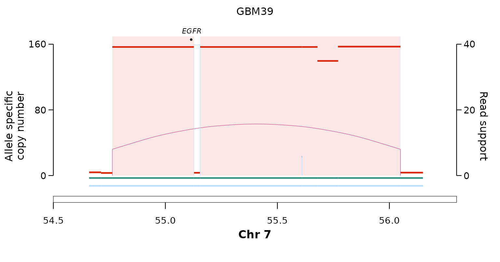
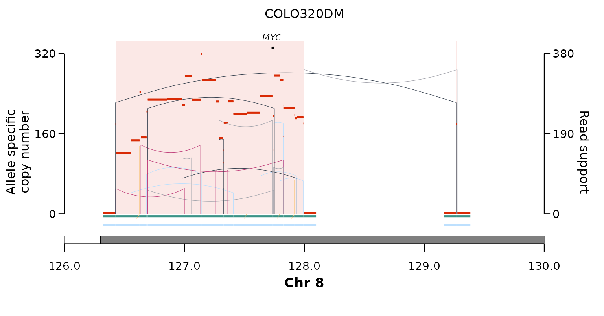

# Calling episomal ecDNA from AmpliconSuite

[`call_simple_excision()`](https://alhafidzhamdan.github.io/EpiTracer/reference/call_simple_excision.md)
([its
vignette](https://alhafidzhamdan.github.io/EpiTracer/articles/calling.md))
works from PURPLE/GRIDSS copy-number and structural-variant calls.
[`call_episomal_from_ampliconsuite()`](https://alhafidzhamdan.github.io/EpiTracer/reference/call_episomal_from_ampliconsuite.md)
applies the **same episome model** directly to
[AmpliconSuite](https://github.com/AmpliconSuite) output —
[AmpliconArchitect](https://github.com/AmpliconSuite/AmpliconArchitect)
(AA) plus
[AmpliconClassifier](https://github.com/AmpliconSuite/AmpliconClassifier)
(AC) — so ecDNA calls from community resources such as
[AmpliconRepository](https://ampliconrepository.org) can be classified
as episomal (simple-excision circle) or not, unified with the
PURPLE-native engine.

It is a **self-contained module** (it does not touch
[`call_simple_excision()`](https://alhafidzhamdan.github.io/EpiTracer/reference/call_simple_excision.md)),
built around three exported functions:

| function | role |
|----|----|
| [`read_ampliconsuite()`](https://alhafidzhamdan.github.io/EpiTracer/reference/read_ampliconsuite.md) | parse an AA `*_graph.txt` into copy-number segments + SV junctions |
| [`aa_cycle_intervals()`](https://alhafidzhamdan.github.io/EpiTracer/reference/aa_cycle_intervals.md) | derive the ecDNA extent from an AA `*_cycles.txt` when there is no AC BED |
| [`call_episomal_from_ampliconsuite()`](https://alhafidzhamdan.github.io/EpiTracer/reference/call_episomal_from_ampliconsuite.md) | classify one AC ecDNA feature as episomal / bridged / complex |

## Inputs

Two files per amplicon, both standard AmpliconSuite output:

- an AmpliconArchitect **`*_graph.txt`** — `sequence` edges are
  copy-number segments (column 4 = `PredictedCopyCount`), `discordant`
  edges are SV junctions (column 3 = junction copy number, column 4 =
  `NumberOfReadPairs`, i.e. the read-pair support the caller uses);
- the AmpliconClassifier ecDNA interval BED
  **`*_amplicon<N>_ecDNA_<k>_intervals.bed`**, which defines the
  **amplicon extent** — AA/AC’s own call, so no copy-number threshold is
  re-applied here.

## Two gold standards

The package bundles the AmpliconSuite output for two well-characterised
ecDNA cell lines (from AmpliconRepository; cell-line data, no patient
data):

- **GBM39** — an *EGFR* ecDNA that is a **simple-excision circle**
  (episomal);
- **COLO320DM** — the canonical *MYC* ecDNA, which is **complex**, not a
  simple excision.

``` r

aa <- function(f) system.file("extdata", "ampliconsuite", f, package = "EpiTracer")

gbm39_graph <- aa("GBM39_EGFR_graph.txt")
gbm39_bed   <- aa("GBM39_EGFR_ecDNA_1_intervals.bed")
colo_graph  <- aa("COLO320DM_MYC_graph.txt")
colo_bed    <- aa("COLO320DM_MYC_ecDNA_1_intervals.bed")
```

[`read_ampliconsuite()`](https://alhafidzhamdan.github.io/EpiTracer/reference/read_ampliconsuite.md)
parses the graph. AA writes each junction in an arbitrary orientation,
so the SV class is assigned **after sorting the two breakends by
coordinate** (`lo`/`hi`): a `lo-`/`hi+` pair is a head-to-tail
duplication — the circulariser. In GBM39 the highest read-pair-support
DUP brackets the EGFR amplicon — the boundary DUP:

``` r

gr <- read_ampliconsuite(gbm39_graph)
gr$junctions[order(-pe_support),
             c("cA", "pA", "cB", "pB", "svclass", "jcn", "pe_support")]
#>        cA       pA     cB       pB svclass      jcn pe_support
#>    <char>    <num> <char>    <num>  <char>    <num>      <num>
#> 1:   chr7 55127266   chr7 55155021     DEL 153.2909         40
#> 2:   chr7 54763282   chr7 56049369     DUP 153.4940          8
#> 3:   chr7 55609119   chr7 55610113     DEL 133.8442          6
```

## Classifying the two amplicons

``` r

gbm39 <- call_episomal_from_ampliconsuite(gbm39_graph, gbm39_bed)
colo  <- call_episomal_from_ampliconsuite(colo_graph,  colo_bed)

cols <- c("status", "episomal", "chimeric", "n_chr",
          "bd_chr", "bd_pe_support", "bd_occupancy", "n_junctions")
cbind(cell_line = c("GBM39", "COLO320DM"), rbind(gbm39, colo)[, cols, with = FALSE])
#>    cell_line   status episomal chimeric n_chr bd_chr bd_pe_support bd_occupancy
#>       <char>   <char>   <lgcl>   <lgcl> <int> <char>         <num>        <num>
#> 1:     GBM39 episomal     TRUE    FALSE     1   chr7             8    0.9776461
#> 2: COLO320DM  complex    FALSE    FALSE     1   <NA>            NA           NA
#>    n_junctions
#>          <int>
#> 1:           3
#> 2:          25
```

**GBM39** is `episomal` — a boundary DUP brackets the EGFR extent, which
is fully amplified (`bd_occupancy ≈ 1`). **COLO320DM** is `complex`: its
25 amplicon junctions contain no single DUP that brackets the MYC ecDNA
extent, so there is no boundary DUP (`bd_chr = NA`) — the discrimination
the caller is built for.

## The episome model

An amplicon is **episomal** when a **boundary DUP** exists:

1.  **Extent** comes from AmpliconSuite itself (the AC ecDNA interval
    BED, or the dominant AA cycle) — no copy-number cutoff is applied
    here.
2.  **Boundary DUP** = an intra-chromosomal duplication whose two ends
    *bracket* the ecDNA’s outer boundary on its chromosome
    (`lo ≤ extent start` and `hi ≥ extent end`).
3.  **Episomal** if ≥ 1 boundary DUP exists. The boundary DUP reported
    is the one with the **highest read-pair support** *among the
    spanning DUPs* — a selector, not a gate: a higher-support DEL or INV
    elsewhere in the amplicon does **not** veto the call.
4.  **Chimeric episomal** — a multi-chromosome ecDNA where *every*
    chromosome is bracketed by its own boundary DUP **and** at least one
    translocation joins them (two episomes fused into one circle).
5.  **Internal structure is ignored** — an episome may be heavily
    rearranged internally (chromothripsis within a micronucleus); only
    the circularising boundary matters, never the junction count.

Two guards reject amplicons that pass the geometry but are not
self-contained circles:

- **Occupancy guard** (`min_occupancy`, default `0.05`) — the
  boundary-DUP bracketed span must be \> 5 % covered by the ecDNA
  intervals. A lone DUP spanning a largely diploid region (e.g. across a
  whole chromosome arm) is not a circle. The default was calibrated on a
  PCAWG-vs-PURPLE concordance sweep.
- **Bridged / ambiguous downgrade** (`bridge_gap`, default `1 Mb`) — if
  the amplicon’s *highest read-pair-support* junction reaches out to
  another **amplified region on the same chromosome** beyond the extent,
  the dominant rearrangement co-mobilises sequence outside the circle,
  so the call is downgraded to `status = "bridged"`. (Cross-chromosome
  translocations are the chimeric signature and are *not* downgraded.)

Every reported field (`bd_pe_support`, `bd_occupancy`, `bridge_partner`,
…) is documented in
[`?call_episomal_from_ampliconsuite`](https://alhafidzhamdan.github.io/EpiTracer/reference/call_episomal_from_ampliconsuite.md).

## Visualising the calls

[`read_ampliconsuite()`](https://alhafidzhamdan.github.io/EpiTracer/reference/read_ampliconsuite.md)
output converts directly into
[`plot_sv_linear()`](https://alhafidzhamdan.github.io/EpiTracer/reference/plot_sv_linear.md)
inputs. A small helper turns the parsed graph into the `cnv_data` /
`sv_data` the plotter expects:

``` r

aa_to_plot <- function(graph, sample) {
  g <- read_ampliconsuite(graph)
  list(
    cnv_data = with(g$segments, data.frame(
      sample = sample, seqnames = chr, start = start, end = end,
      copyNumber = cn, ploidy = 2,
      majorAlleleCopyNumber = cn, minorAlleleCopyNumber = 0)),
    sv_data = with(g$junctions, data.frame(
      sample = sample,
      chrom1 = cA, start1 = pA, strand1 = sA,
      chrom2 = cB, start2 = pB, strand2 = sB,
      svclass = svclass, VF = pe_support, JCN = jcn)))
}
```

**GBM39 (episomal)** — the amplified EGFR segment bounded by a single
duplication junction (the boundary DUP): a clean simple-excision circle.

``` r

gbm39_pl <- aa_to_plot(gbm39_graph, "GBM39")
plot_sv_linear(
  sample   = "GBM39",
  cnv_data = gbm39_pl$cnv_data,
  sv_data  = gbm39_pl$sv_data,
  chromosome       = "chr7",
  chromosome_range = matrix(c(54.5e6, 56.3e6), nrow = 1)
)
```



**COLO320DM (complex)** — the MYC amplicon is a tangle of duplications,
inversions and translocations (it even co-amplifies segments on other
chromosomes), with no single DUP bracketing the extent: not a
simple-excision circle.

``` r

colo_pl <- aa_to_plot(colo_graph, "COLO320DM")
plot_sv_linear(
  sample   = "COLO320DM",
  cnv_data = colo_pl$cnv_data,
  sv_data  = colo_pl$sv_data,
  chromosome       = "chr8",
  chromosome_range = matrix(c(126e6, 130e6), nrow = 1)
)
```



## Bare AA runs (no AmpliconClassifier)

For an AA run without AC, take the extent from the reconstructed cycle:
[`aa_cycle_intervals()`](https://alhafidzhamdan.github.io/EpiTracer/reference/aa_cycle_intervals.md)
reads the dominant (highest-copy) cycle’s segments from a `*_cycles.txt`
(dropping the AA source vertex, segment `0`). You can pass the
`*_cycles.txt` path straight to `intervals` — the caller detects it:

``` r

call_episomal_from_ampliconsuite(
  graph_file = "SAMPLE_amplicon1_graph.txt",
  intervals  = "SAMPLE_amplicon1_cycles.txt")   # extent from the dominant cycle
```

## Using your own data

Point the two arguments at the matching files from an AmpliconSuite run
or an AmpliconRepository download:

``` r

call_episomal_from_ampliconsuite(
  graph_file = "SAMPLE_amplicon1_graph.txt",
  intervals  = "SAMPLE_amplicon1_ecDNA_1_intervals.bed")
```

Chromosome names may carry a `chr` prefix or not, as long as the graph
and the BED agree. One AC amplicon can yield several ecDNA features
(`ecDNA_1`, `ecDNA_2`, …); classify each by passing its own interval BED
with the shared `*_amplicon<N>_graph.txt`. Breakpoint homology is often
absent from AA graphs (the field is written `None`), so for a homology
signature use the PURPLE-native
[`call_simple_excision()`](https://alhafidzhamdan.github.io/EpiTracer/reference/call_simple_excision.md)
path instead.
