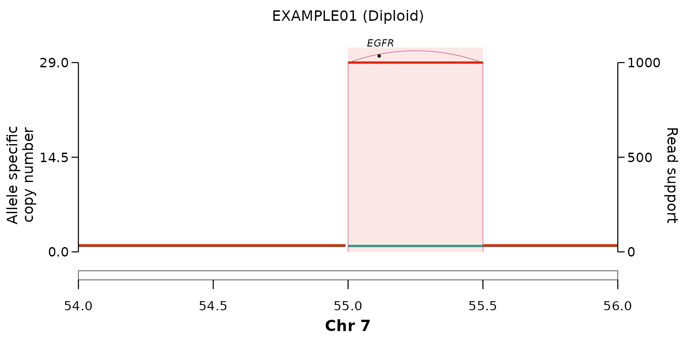

# Calling episomal ecDNA

[`call_simple_excision()`](https://alhafidzhamdan.github.io/EpiTracer/reference/call_simple_excision.md)
flags ecDNA amplicons most likely generated by a *simple excision and
re-circularisation* event — an **episome** — rather than by a complex,
breakage-driven process. For each amplicon it inspects the
structural-variant breakpoints at the boundaries and applies the
*episome heuristic*: a boundary duplication (DUP) carrying the highest
variant fraction (`VF`), non-gained flanking segments (consistent with a
circle excised from an otherwise diploid region), and a candidate
deletion “excision scar”.

## The example data

The package bundles a textbook **episomal EGFR ecDNA** on chr7
(fictional sample `"EXAMPLE01"`), in the AmpliconArchitect +
PURPLE-style `GRanges` the caller expects. The data are synthetic (no
patient data).

``` r

names(ex_caller_inputs)
#> [1] "ecdna_gr"        "breakpoints_gr"  "cnv_gr"          "cancer_genes_gr"
```

## Calling

``` r

res <- call_simple_excision(
  ecdna_gr        = ex_caller_inputs$ecdna_gr,
  breakpoints_gr  = ex_caller_inputs$breakpoints_gr,
  cnv_gr          = ex_caller_inputs$cnv_gr,
  cancer_genes_gr = ex_caller_inputs$cancer_genes_gr
)

res[, c("event", "svclass", "VF", "duplication_at_boundary",
        "episomal", "has_excision_scar")]
#>     event svclass    VF duplication_at_boundary episomal has_excision_scar
#>    <char>  <char> <num>                  <char>   <char>            <char>
#> 1:   DEL1     DEL   200                   FALSE     TRUE              TRUE
#> 2:   DUP1     DUP  1000                    TRUE     TRUE              TRUE
#> 3:   DUP1     DUP  1000                    TRUE     TRUE              TRUE
#> 4:   DEL1     DEL   200                   FALSE     TRUE              TRUE
```

The boundary duplications carry the highest `VF` in the amplicon, the
flanks are diploid, and a deletion scar is present — so every breakpoint
of this amplicon is classified `episomal = "TRUE"` with
`has_excision_scar = "TRUE"`. An amplicon with the *same* boundary DUP
but **gained** flanks (i.e. not excised from a diploid region) is
instead returned as `episomal = "FALSE"` — the discrimination the caller
is built for.

## Visualising the call

Plotting the same locus makes the episome signature explicit: a sharp
copy-number step over the EGFR amplicon bounded by a duplication
junction (the circularising boundary DUP), with diploid flanks on either
side.

``` r

plot_sv_linear(
  sample   = "EXAMPLE01",
  cnv_data = ex_plot_inputs$cnv_data,
  sv_data  = ex_plot_inputs$sv_data,
  wgd_data = ex_plot_inputs$wgd_data,
  chromosome       = "chr7",
  chromosome_range = matrix(c(54e6, 56e6), nrow = 1)
)
```



See the [plotting
vignette](https://alhafidzhamdan.github.io/EpiTracer/articles/plotting.md)
for the full set of controls.

## Running without AmpliconArchitect

AmpliconArchitect is optional. Pass `ecdna_gr = NULL` and EpiTracer
detects the focal-amplicon seeds directly from the copy-number segments
(via
[`detect_amplicon_seeds()`](https://alhafidzhamdan.github.io/EpiTracer/reference/detect_amplicon_seeds.md)),
so it can run from SV + CN alone:

``` r

res2 <- call_simple_excision(
  ecdna_gr        = NULL,
  breakpoints_gr  = ex_caller_inputs$breakpoints_gr,
  cnv_gr          = ex_caller_inputs$cnv_gr,
  cancer_genes_gr = ex_caller_inputs$cancer_genes_gr
)
unique(res2$episomal)
#> [1] "TRUE"
```

## Using your own data

The inputs mirror the columns EpiTracer expects from real pipelines:
ecDNA amplicon regions from
[AmpliconArchitect](https://github.com/AmpliconSuite/AmpliconArchitect)
and allele-specific SV / copy-number calls from
[PURPLE](https://github.com/hartwigmedical/hmftools/tree/master/purple)
(Hartwig Medical Foundation pipeline). See
[`?call_simple_excision`](https://alhafidzhamdan.github.io/EpiTracer/reference/call_simple_excision.md)
for the required metadata columns — SV/CN calls from any pipeline can be
coerced to the same shape, and missing columns produce an explicit
error.
